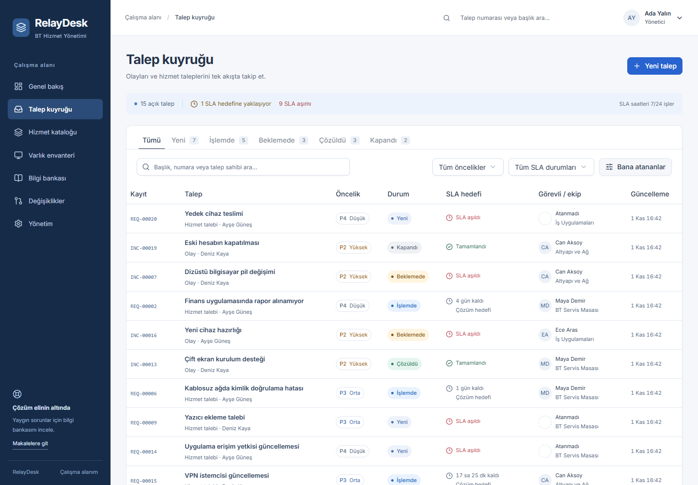
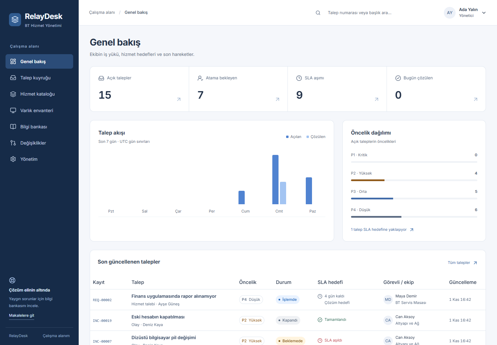
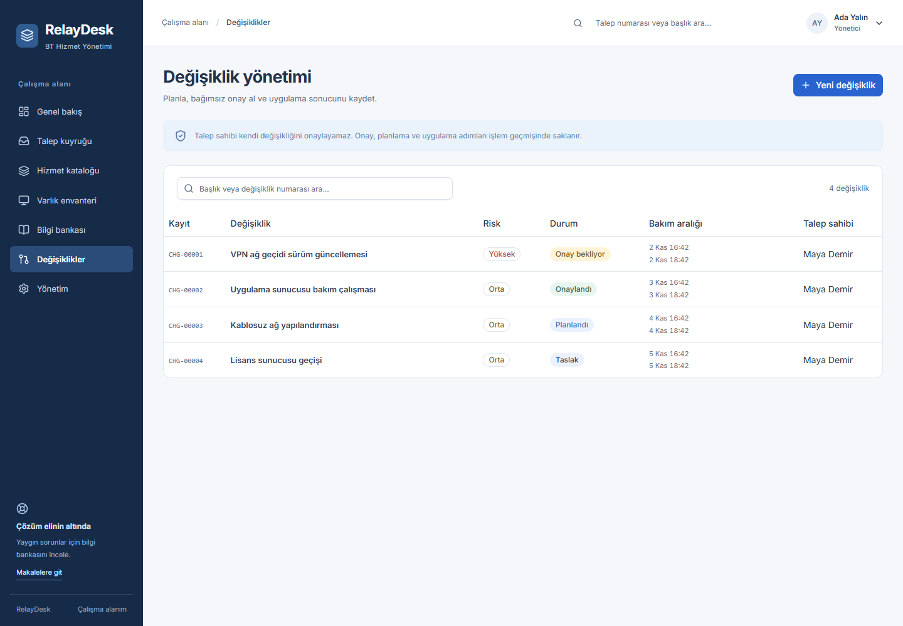
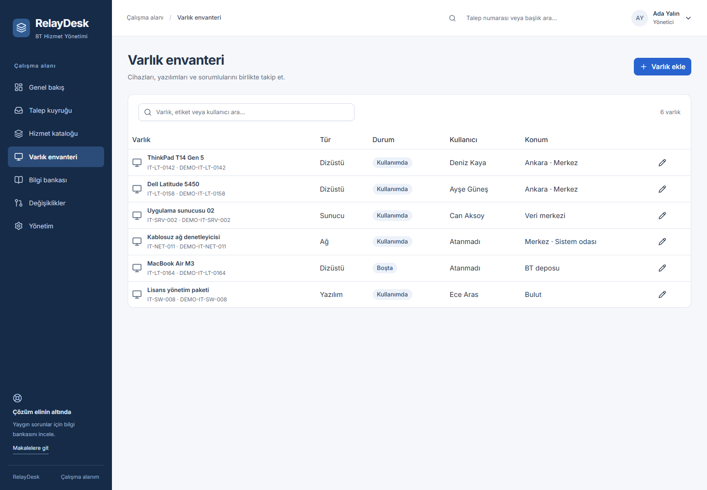

# RelayDesk ITSM

Türkçe arayüzlü bir BT hizmet yönetimi uygulaması. Çalışan taleplerini, destek ekiplerinin iş kuyruğunu, SLA hedeflerini, varlıkları ve planlı değişiklikleri aynı çalışma alanında yönetir.

**Next.js · NestJS · TypeScript · shadcn/ui · TanStack Query · Zod · TypeORM · PostgreSQL**



## Kapsam

- **Olay ve hizmet talepleri:** arama, durum/öncelik/SLA filtreleri, bana atananlar, sunucuda sayfalama ve sıralama.
- **Talep yaşam döngüsü:** ekip ve görevli atama, etki/acıliyetten hesaplanan öncelik, zorunlu çözüm açıklaması, çalışan yorumları ve personele özel iç notlar.
- **SLA:** ilk yanıt ve çözüm hedefleri, yaklaşan/aşılmış hedefler, beklemede çözüm saatinin durması, yönetilebilir öncelik politikaları.
- **Hizmet kataloğu:** önceden tanımlı hizmetlerden talep açma ve ilgili ekibe yönlendirme.
- **Varlık envanteri:** benzersiz etiket, tür, seri numarası, sorumlu, konum ve kullanım/bakım/emekli durumları.
- **Bilgi bankası:** kategori, arama, taslak ve yayın akışı. Çalışanlar yalnız yayınlanmış makaleleri görür.
- **Değişiklik yönetimi:** uygulama ve geri dönüş planı, bakım penceresi, risk, bağımsız yönetici onayı ve uygulama sonucu.
- **Yönetim:** kullanıcı/rol/ekip, katalog ve SLA politikaları. Son aktif yönetici erişimi eş zamanlı güncellemelere karşı korunur.
- **Genel bakış:** veritabanından hesaplanan kuyruk, öncelik ve son yedi günün talep/çözüm verileri.

## Yerelde çalıştırma

Node.js 22.12+ ve Docker Compose gerekir. Aşağıdaki komutları depo kökünde çalıştırın:

```sh
npm ci
npm run setup
npm run dev
```

Web: http://127.0.0.1:5501 · API sağlık kontrolü: http://127.0.0.1:4401/api/health

`setup`, eksikse `.env` oluşturur; rastgele bir demo parolası üretir, PostgreSQL'i başlatır, migration ve örnek verileri yükler. **Parola yalnız yerel, git tarafından yok sayılan `.env` dosyasındaki `SEED_PASSWORD` alanındadır.** Konsola veya depoya yazılmaz. Örnek adlar ve bütün kayıtlar kurgusaldır.

| Hesap                     | Rol              | Deneme akışı                                                      |
| ------------------------- | ---------------- | ----------------------------------------------------------------- |
| `admin@relaydesk.test`    | Yönetici         | Tüm modüller ve yönetim                                           |
| `approver@relaydesk.test` | Yönetici         | Diğer kullanıcının değişikliğini onaylama                         |
| `agent@relaydesk.test`    | Destek personeli | Atama, iç not, envanter, makale ve değişiklik                     |
| `employee@relaydesk.test` | Çalışan          | Kendi talepleri, kendisine ait varlıklar ve yayınlanmış makaleler |

Örnek hesaplar aynı yerel demo parolasını kullanır. Kendi değişikliğinizi onaylayamazsınız; ikinci yöneticiyle giriş yapın. Mevcut kullanıcılar varsa seed yeniden örnek kayıt eklemez veya verileri sıfırlamaz. Demo seed production ortamında çalışmaz.

```sh
npm run build        # contracts + API + optimize edilmiş web derlemesi
npm test             # ayrı geçici PostgreSQL veritabanında HTTP entegrasyon testleri
npm run db:down      # PostgreSQL konteynerini durdurur; veriler korunur
```

Derlenmiş uygulamayı yerelde incelemek için iki terminalde `npm run start -w @relaydesk/api` ve `npm run start -w @relaydesk/web` kullanın. Geliştirme sunucularını önce durdurun. `.env` içindeki geliştirme ayarları yerel kullanım içindir.

## Mimari

```text
apps/
  web/src/
    app/                 Next.js App Router sayfaları ve layout
    features/            Talep, varlık, bilgi, değişiklik, yönetim ekranları
    components/ui/       shadcn bileşen kaynakları
    lib/                 API istemcisi, query anahtarları ve biçimlendirme
  api/src/
    model/               TypeORM entity modelleri
    auth/                Repository → Service → Controller
    tickets/             Repository → Service → Controller
    resources/           Envanter, bilgi, değişiklik ve yönetim katmanları
    dashboard/           Repository → Service → Controller
    database/            Sürümlü migration ve geliştirme seed'i
packages/contracts/      Ortak Zod şemaları, DTO'lar, enum ve etiketler
```

Controller, HTTP ve Zod doğrulamasını; service, yetki ve iş kurallarını; repository, veritabanı sorgularını taşır. Birden çok kaydı etkileyen işlemler transaction içinde yürür. Güncellemeler satır kilidi ve `version` kontrolü kullanır; eski form verisiyle yapılan işlem `409` döner. TypeORM `synchronize` kapalıdır.

TanStack Query gerçek API verilerini önbellekler; mutasyonlar ilgili sorguları geçersizleştirir. Oturum değişiminde kişiye özel önbellek temizlenir. Formlar React Hook Form ve ortak Zod sözleşmeleriyle doğrulanır. shadcn bileşenleri tek bir yerel kaynak ağacındadır; tema semantik değişkenler ve uygulamaya ait CSS üzerinden tanımlıdır.

## Yetkiler ve iş kuralları

| İşlem                                    | Çalışan         | Personel   | Yönetici         |
| ---------------------------------------- | --------------- | ---------- | ---------------- |
| Talep okuma                              | Kendi kayıtları | Tüm kuyruk | Tüm kuyruk       |
| Talep açma / kendi talebine yorum        | Evet            | Evet       | Evet             |
| Atama, durum, iç not ve işlem geçmişi    | Hayır           | Evet       | Evet             |
| Varlık okuma                             | Kendisine ait   | Tümü       | Tümü             |
| Varlık / makale yönetimi                 | Hayır           | Evet       | Evet             |
| Yayınlanmış makale okuma                 | Evet            | Evet       | Evet             |
| Değişiklik oluşturma ve yürütme          | Hayır           | Evet       | Evet             |
| Değişiklik onayı                         | Hayır           | Hayır      | Başkasının kaydı |
| Kullanıcı, ekip, katalog ve SLA yönetimi | Hayır           | Hayır      | Evet             |

SLA **7/24 geçen süre** üzerinden hesaplanır; mesai/tatil takvimi içermez. Bekleme, çözüm süresini durdurur; ilk yanıt süresini durdurmaz. Süre aşıldıktan sonra beklemeye alınması geçmiş aşımı gizlemez. Politika düzenlemek mevcut taleplerin teslim tarihlerini değiştirmez. İlk yanıt personelin herkese açık yorumu ile kaydedilir; iç not ilk yanıt sayılmaz.

## API

Bütün yollar `/api` altındadır. Yanıtlar `{ data }`, hatalar `{ error, details? }` biçimindedir. Yazma istekleri `x-relaydesk-request: 1` başlığı ve uygun `Origin` gerektirir. Web bunları kendi sunucusundaki `/api` proxy üzerinden gönderir.

| Yollar                                                                                    | Kullanım                  |
| ----------------------------------------------------------------------------------------- | ------------------------- |
| `POST /auth/login`, `GET /auth/me`, `POST /auth/logout`                                   | Oturum                    |
| `GET, POST /tickets`, `GET, PATCH /tickets/:id`                                           | Kuyruk ve talep           |
| `POST /tickets/:id/comments`                                                              | Yorum / iç not            |
| `GET /dashboard`, `GET /reference`                                                        | Rapor ve form seçenekleri |
| `GET, POST /assets`, `PUT /assets/:id`                                                    | Envanter                  |
| `GET, POST /articles`, `PUT /articles/:id`                                                | Bilgi bankası             |
| `GET, POST /changes`, `GET, PUT /changes/:id`, `PATCH /changes/:id/status`                | Değişiklik akışı          |
| `GET /settings`, `POST /users`, `PUT /users/:id`                                          | Yönetim                   |
| `POST /teams`, `PUT /teams/:id`, `POST /catalog`, `PUT /catalog/:id`, `PUT /policies/:id` | Ekip / katalog / SLA      |

## Doğrulama

13 gerçek HTTP/PostgreSQL entegrasyon testi; oturum iptali, istek kaynağı, kayıt gizliliği, Zod doğrulaması, transaction geri dönüşü, sürüm çakışması, SLA, iç notlar, bağımsız onay ve eş zamanlı yönetici güncellemelerini kapsar. Test çalıştırıcısı yalnız kendi rastgele adlandırdığı test veritabanını temizler; geliştirme verilerine dokunmaz.

Masaüstü ve mobilde ana modüller; tarayıcıda talep açma/atama/yorum, varlık ekleme, makale yayınlama, değişiklik gönderme/onaylama ve çalışan erişimi ayrıca kontrol edilmiştir. Bu kontroller yereldir; GitHub Actions çalışmış olduğu iddia edilmez.

## Uygulama sınırları

Bu sürüm tek kurum içi kullanım için geliştirilmiştir. Çok kiracılı yapı, SSO/MFA, parola sıfırlama, dosya eki, e-posta alımı, bildirim servisi, problem yönetimi ve CMDB ilişki grafiği içermez. Envanter, makale ve değişiklik listeleri istemcide filtrelenir; büyük hacimde sunucu sayfalaması gerekir. Giriş limiti işlem belleğindedir; çok örnekli dağıtımda ortak bir limiter gerekir.

Canlı dağıtımda PostgreSQL kimlik bilgileri ve yedekleme, HTTPS, `NODE_ENV=production`, doğru `PUBLIC_ORIGIN`, özel API ağı ve yönlendirme/limitleme ayarları ayrıca yapılandırılmalıdır. `INTERNAL_API_URL` Next.js derlemesinde okunur; değiştirdiğinizde web'i yeniden derleyin. Production oturum çerezi `Secure` olur. Örnek verili bir ortamı canlı kullanıcı verileriyle birleştirmeyin.

## Diğer ekranlar





Ekran görüntüleri yerelde çalışan uygulamadan, kurgusal örnek verilerle alınmıştır. Tasarım sistemi [DESIGN.md](DESIGN.md), doğrulama özeti [docs/VALIDATION.md](docs/VALIDATION.md) içindedir. Üçüncü taraf bileşenler için [THIRD_PARTY.md](THIRD_PARTY.md).
